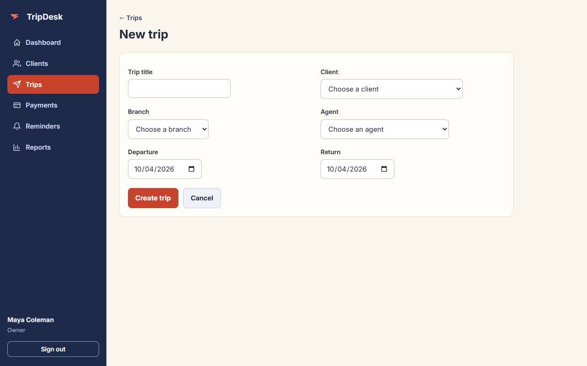
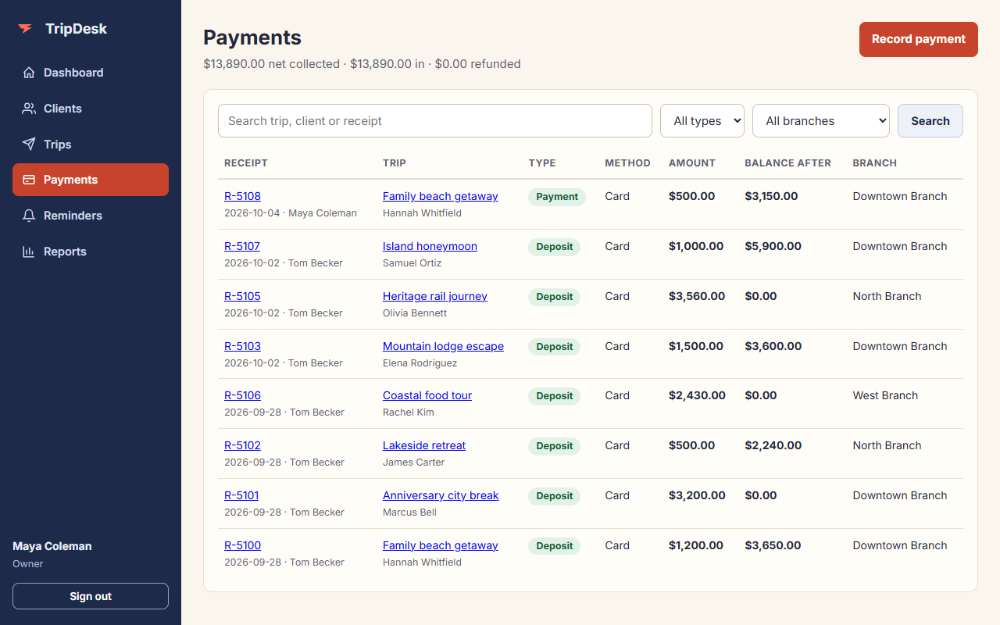
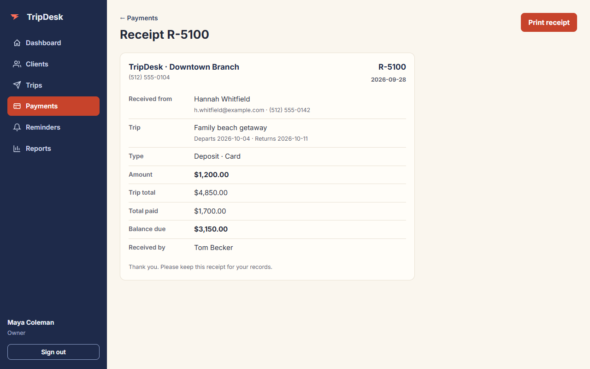
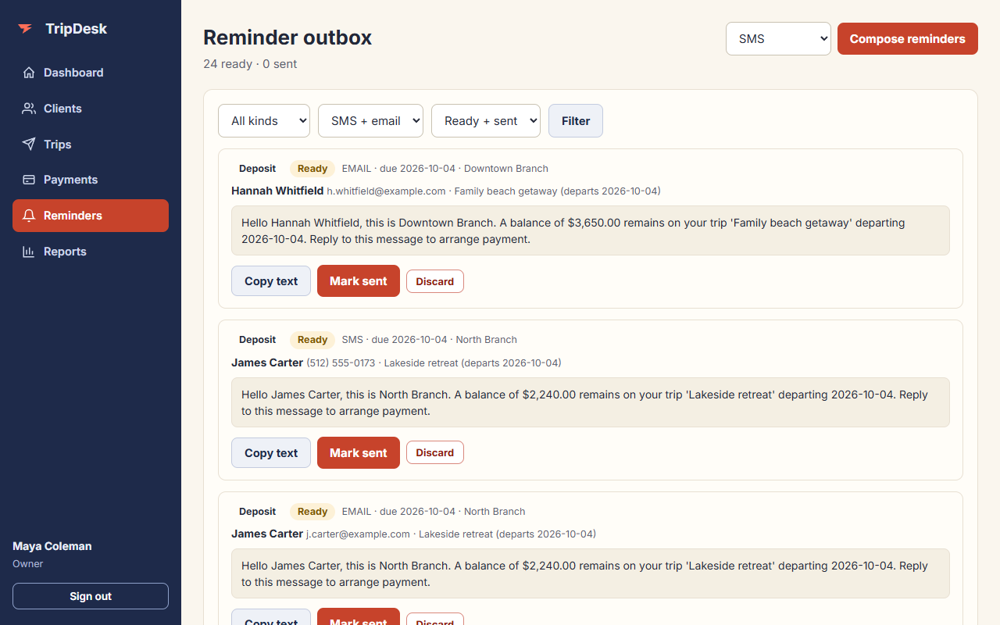
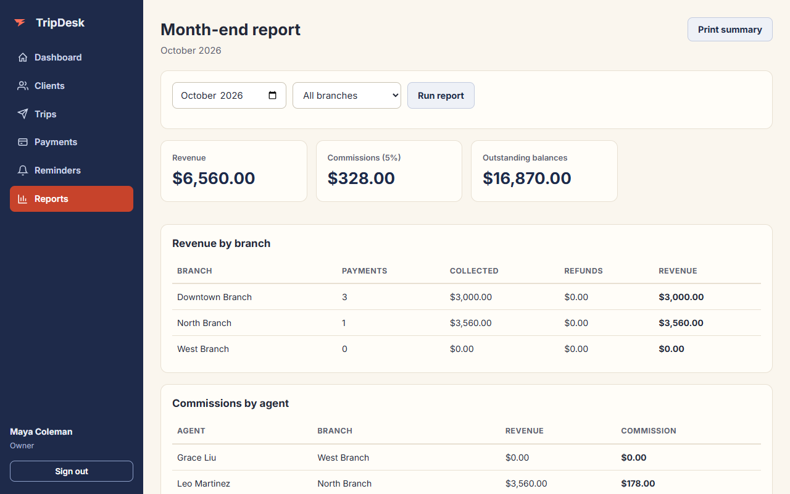

# TripDesk

TripDesk is an operations console for travel agency staff. It tracks clients, trips, payments, reminders, and month-end reports across three branches.

## Getting started

```bash
pip install -r requirements.txt
py app.py
```

Open http://127.0.0.1:5000. The first start creates and seeds the database.

Run tests: `py -m pytest`.

## Test accounts

| Login | Password | Can do |
| --- | --- | --- |
| owner@tripdesk.local | Passw0rd! | Everything, all branches, locks months |
| manager@tripdesk.local | Passw0rd! | Branch clients, trips, payments, reminders |
| agent@tripdesk.local | Passw0rd! | Branch clients, trips, reminders |
| accountant@tripdesk.local | Passw0rd! | Payments and month-end reports |

## Walkthrough

1. Sign in with a staff account. 
2. Check today's departures, unpaid balances, and per-branch stats. 
3. Search clients and spot passport flags at a glance. 
4. Open a client profile for contact details, passport info, and trip history. 
5. Browse trips by branch and booking status. 
6. Open a trip dossier, update its booking status, and review itinerary and suppliers. 
7. Build a new trip with client, dates, and assigned agent. 
8. Record deposits and refunds and watch trip balances update. 
9. Print a receipt for any payment. 
10. Copy ready-made reminder texts for deposits, departures, and passport expiry. 
11. Run the month-end report, check commissions, and lock the month as reviewed. 

## Built with

Python, Flask, SQLite, Jinja templates, and vanilla JS.
