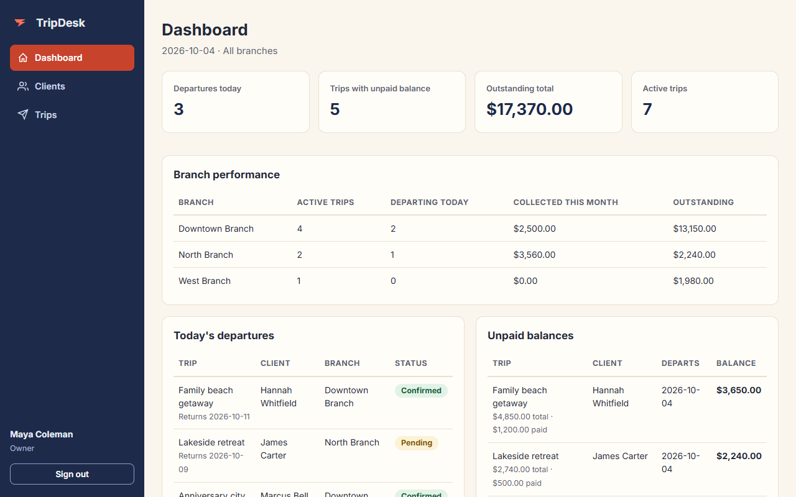
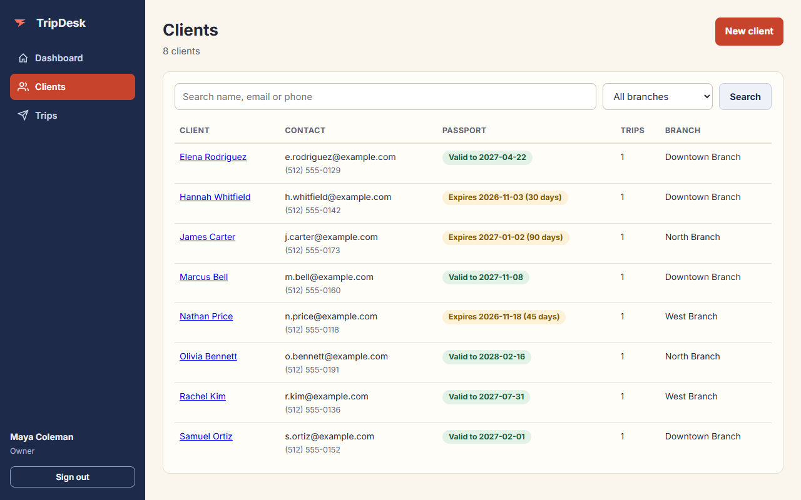
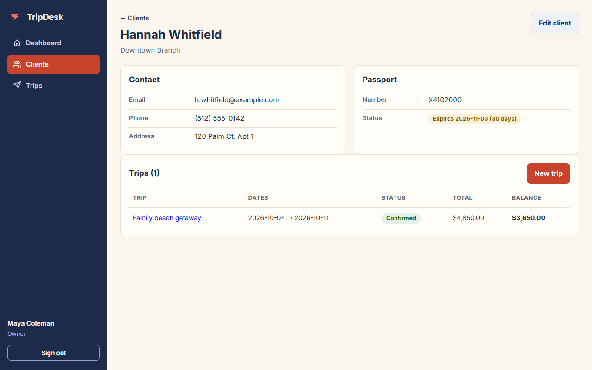
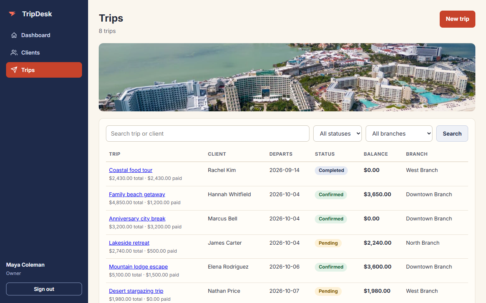
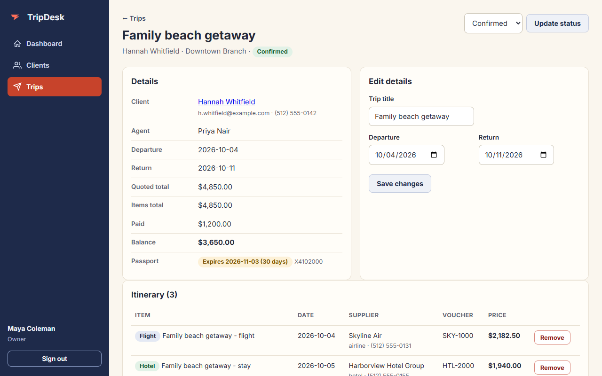

# TripDesk

TripDesk is an operations console for travel agency staff to manage clients, trips, payments, and month-end reports across three branches.

## Getting started

Requires Python 3.10 or newer.

```bash
pip install -r requirements.txt
py app.py
```

Open http://127.0.0.1:5000 in a browser. On first start the app creates `tripdesk.db` and seeds demo data with departures around today so every screen has something to show.

Run the tests:

```bash
py -m pytest
```

## Demo accounts

All demo passwords are `Passw0rd!`.

| Role | Email |
| --- | --- |
| Owner | owner@tripdesk.local |
| Branch manager | manager@tripdesk.local |
| Agent | agent@tripdesk.local |
| Accountant | accountant@tripdesk.local |

The owner sees all branches. Managers, agents, and accountants only see their own branch.

## What staff can do

- Dashboard: today's departures, unpaid balances, and per-branch stats.
- Clients: searchable client list with passport status flags, profiles with contact details and passport info, and full trip history with balances.
- Trips: searchable trip list filtered by status and branch, trip dossiers with dates, booking status, supplier details and vouchers, plus itinerary items staff can add or remove. Owners and branch managers update booking status.
- Sign-in is required for every staff page. The accountant role cannot open clients or trips.







